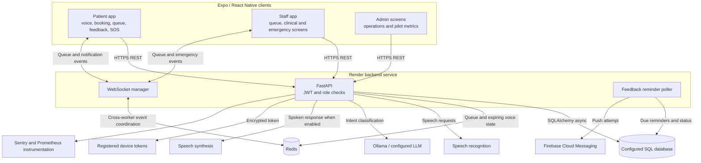

# Final Architecture Diagram

The diagram reflects the current repository wiring. External services are conditional on deployment configuration.

## Data paths

- Booking and queue state are persisted in the configured SQL database. Redis holds short-lived voice confirmation state and coordinates live updates.
- Patient voice transcripts and selected patient information are encrypted through project SQLAlchemy types; see [Security and Compliance](security-compliance.md).
- Feedback reminders are persisted with due times and polled by application workers. Push delivery requires an active registered device token and Firebase configuration; the in-app notification is also stored.
- Tests use SQLite for most isolated unit cases and an explicitly configured Redis service for integration cases.
