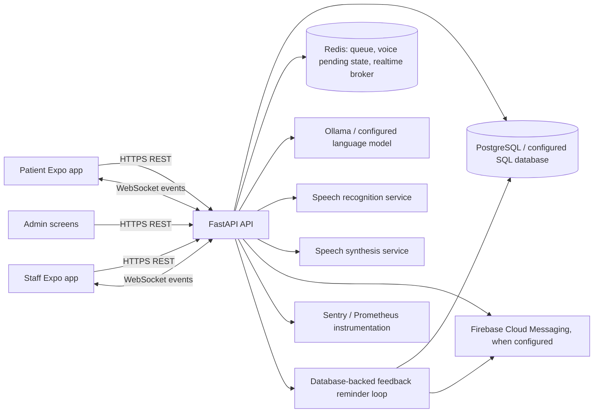
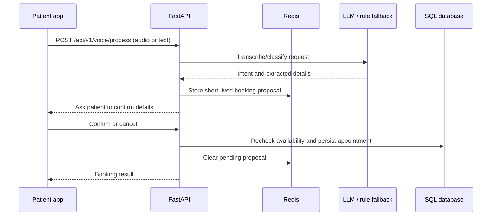

# Naviora AI Architecture

This describes the checked-in application and Render deployment configuration. It is not a claim that every integration is configured in production.

## System view

## Runtime components

- **Frontend:** Expo / React Native source under `frontend/src`. Patient, staff, and admin navigators select role-specific screens. Mobile audio capture is implemented in the patient Voice Assistant.
- **API:** FastAPI routes under `backend/app/api/v1/endpoints`, mounted under `/api/v1`. Request validation uses Pydantic; database work uses SQLAlchemy async sessions.
- **Database:** SQLAlchemy models under `backend/app/models`; Alembic migrations under `backend/alembic/versions`. Production startup in `render.yaml` applies `alembic upgrade head` before starting Uvicorn.
- **Redis:** Used by voice pending/clarification state and realtime queue/event coordination. Redis is a required runtime dependency for those workflows.
- **Voice:** Audio is transcribed by the STT service; intent is classified by HospitalBrain with a rule-based fallback when the LLM is unavailable. Appointment proposals require an explicit confirmation and pending state has a short Redis TTL.
- **Realtime:** WebSocket manager broadcasts patient and staff queue updates; Redis coordinates events between API workers.
- **Feedback reminders:** Completed appointments create a persistent reminder due one hour later. API workers poll the database and dispatch through the existing push service; the reminder row survives process restart.
- **Observability:** `/health`, `/health/detailed`, `/ready`, and `/metrics` provide operational signals. Sentry and Firebase depend on production configuration.

## Main patient booking flow

## Deployment boundary

`.github/workflows/test.yml` runs backend tests with a Redis service and frontend type/unit tests. On successful Test workflow completion for `main`, `.github/workflows/deploy.yml` calls the Render deploy hook and polls the configured health endpoint. The Render service plan, secrets, external providers, and mobile store release are outside this repository's architecture diagram and must be verified separately.
